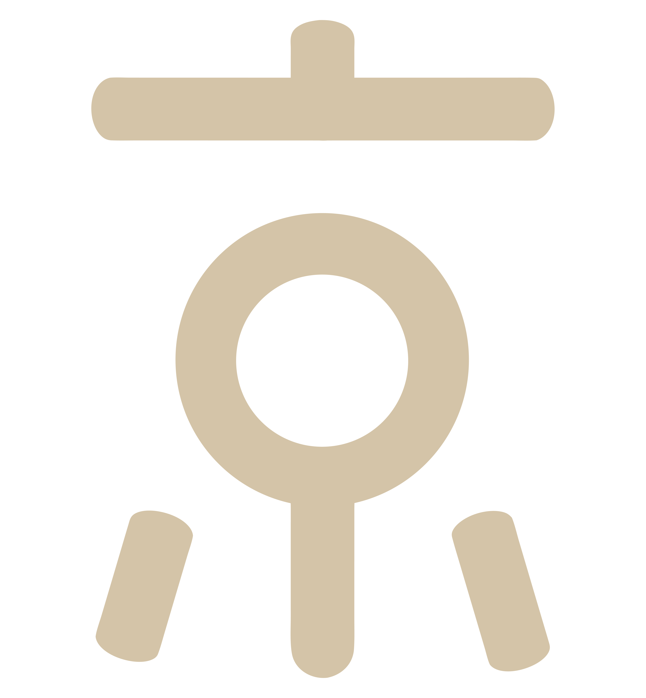

<h1 align="center"> Yugos</h1>

<p align="center">
  <strong><code>Bittensor SN34</code></strong><br>
  Better answers. Lower cost. Less time.
</p>

<p align="center">
  <a href="https://yugos.ai">Website</a> ·
  <a href="https://competition.yugos.ai">Dashboard</a> ·
  <a href="docs/miner.md">Mining</a> ·
  <a href="docs/validator.md">Validating</a>
</p>

<p align="center">
  <a href="docs/models.md">Models</a> ·
  <a href="docs/scoring.md">Scoring</a> ·
  <a href="examples/starter-router">Example router</a> ·
  <a href="llms.txt">Agent guide</a>
</p>

Yugos is a Bittensor subnet whose purpose is to produce the best System One
decision model for inference. For each request, the model chooses the
inference model, the provider, and the effort. The subnet rewards the
decision model that gets the best answers at the lowest cost in the least time.

## How a round works

1. A miner packages trained router weights and inference code, then submits them with a registered hotkey.
2. The service evaluates the router. Each model turn selects one provider, model and effort; the service forwards the original request, grades the response, and records cost and time.
3. A challenger replaces the champion only when it clears the category gates and its net value is high enough. See [Scoring](docs/scoring.md).
4. Validators read the published result and set on-chain weights: 85% to the current champion, 10% to the previous one, and 5% to the one before that.

The chain commitment is an audit record of the uploaded archive. Evaluation starts when the service accepts the upload.

## Install

Python 3.11 or newer. One environment covers the miner and validator commands.
Yugos does not create wallets. Use a wallet you already have under
`~/.bittensor/wallets`.

```sh
uv venv --python 3.12
source .venv/bin/activate
uv pip install "yugos @ git+https://github.com/BitMind-AI/yugos.git"
```

From a checkout, `uv sync` installs it (and `yugos-evals`) for development. Local benchmark
runs also need the separate benchmark package, `yugos-evals`:

```sh
uv pip install "yugos @ git+https://github.com/BitMind-AI/yugos.git" \
  "yugos-evals @ git+https://github.com/BitMind-AI/yugos.git#subdirectory=packages/yugos-evals"
```

`yugos[inspect]` adds Inspect Evals for hosts that grade benchmarks. Miners and
validators that only submit or set weights do not need it.

## Repository

| Package | What it is |
| --- | --- |
| [`yugos`](packages/yugos) | Competition rules, the miner and validator commands, and the submission interface. |
| [`yugos-evals`](packages/yugos-evals) | Benchmark catalog and a local runner for trying a router on your own machine. |

The evaluation service prepares the live benchmark and runs submissions. This
repository does not download competition datasets at grade time.

Competition history supports explicit [pack revisions](docs/pack-revisions.md) that
retain the king and reward seats. A new contest can still start with empty history.

## Development

The repository is a [uv workspace](https://docs.astral.sh/uv/concepts/projects/workspaces/).

```sh
uv sync
uv run --package yugos --extra inspect pytest packages/yugos/tests -q
uv run --package yugos-evals pytest packages/yugos-evals/tests -q
uv run ruff check .
uv run ruff format --check .
```

Core tests can run without the Inspect extra. Engine tests skip in that case:

```sh
uv run --isolated --package yugos --no-default-groups \
  --extra dev pytest packages/yugos/tests -q
```

Docker-backed code-task checks require Docker and explicit opt-in:

```sh
YUGOS_EVALS_DOCKER_TESTS=1 uv run --package yugos-evals pytest packages/yugos-evals/tests/test_code_tests.py -q
```

Local world-card caches default to `~/.cache/yugos-evals/world-cards/`; set `YUGOS_EVALS_CACHE` to use a different cache root during development.
